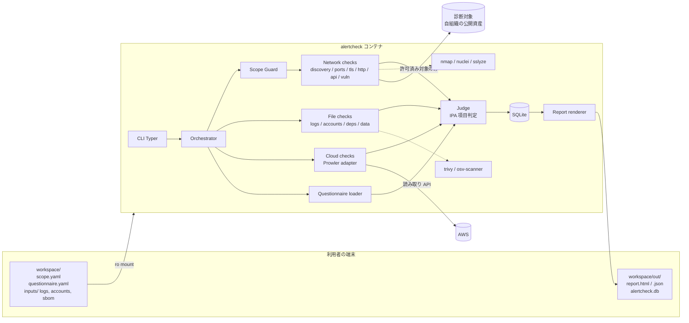
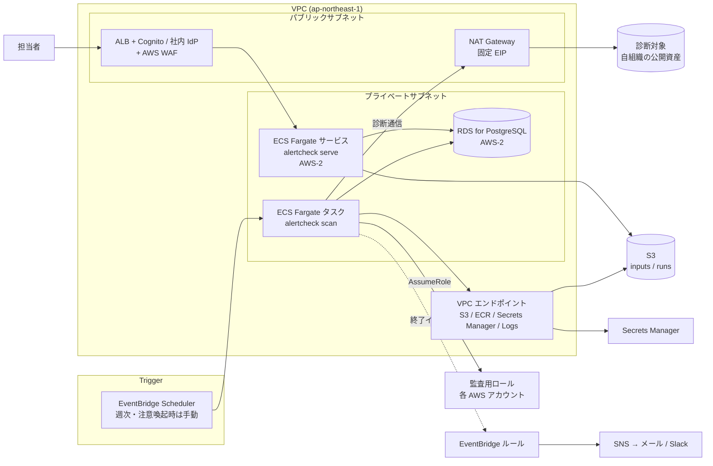

# alertcheck 設計書

[仕様書](./spec.md) で定めた要件を実現するための構成・データモデル・検査ロジックを定める。

- 版: 0.1（初版ドラフト）
- 作成日: 2026-10-17

## 1. 技術選定

### 1.1 実装言語: Python 3.13

| 候補 | 評価 |
|---|---|
| **Python** | 採用。ログ解析・CSV 処理・統計（pandas 不要の範囲は標準ライブラリで足りる）、HTTP クライアント（httpx の async）、TLS 検査（sslyze）、レポート生成（Jinja2）のライブラリが揃っている。Prowler も Python 製で、ライブラリとして呼べる。セキュリティ担当者が検査を追加しやすい |
| Go | 単一バイナリ配布と並行処理に強いが、Docker 前提なら配布の利点は薄い。ログ・台帳の柔軟な解析やレポート生成でコード量が増える |
| TypeScript | Web UI との共通化は利点だが、TLS 検査やセキュリティ系ライブラリが手薄 |

バージョンは 3.13 とする。2026-10 時点で 3.14・3.15 も出ているが、Prowler 5.x が `requires-python <3.14` のため、依存ライブラリをすべて満たす最新は 3.13 になる（sslyze / nassl は 3.14 まで対応）。3.13 のサポート期限は 2029-10。Prowler が 3.14 に対応した時点で引き上げを検討する。

高速さが要る部分（ポート探索、テンプレート検査、脆弱性 DB 照合）は実績のある外部 OSS に任せ、Python はオーケストレーション・解析・判定・レポートを担う。

### 1.2 主要ライブラリ・外部ツール

| 用途 | 採用 | 備考 |
|---|---|---|
| CLI | Typer | サブコマンド・補完 |
| 設定・モデル | Pydantic v2 | `scope.yaml` 等の検証、Finding のスキーマ |
| HTTP | httpx（async） | レート制限は自前のトークンバケットで実装 |
| TLS | sslyze | プロトコル・暗号スイート・証明書 |
| ポート探索 | nmap | `-sT`（TCP connect）+ `-sV`。raw socket 権限を不要にする |
| テンプレート検査 | Nuclei | `-tags exposure,misconfig` かつ `-etags intrusive,dos,fuzz` |
| 依存脆弱性 | Trivy、OSV-Scanner | ロックファイル・SBOM・イメージ |
| バージョン照合 | OSV API / Trivy DB、CISA KEV JSON | オフライン時はキャッシュを使用 |
| クラウド設定 | Prowler（第 2 段階） | 読み取り専用 |
| 保存 | SQLite（SQLAlchemy Core 経由） | 実行履歴・Finding・前回差分。AWS 展開時は PostgreSQL に切り替える（14.4） |
| レポート | Jinja2 | CSS をインライン化した単一 HTML |
| Web UI | FastAPI + HTMX（第 2 段階） | ビルド工程なし |
| テスト | pytest、respx（HTTP モック） | |

## 2. 全体構成



処理の流れは次の通り。

1. `validate`: `scope.yaml`・質問票・入力ファイルを Pydantic で検証し、実行計画（どの検査を、どの入力で実行し、どの IPA 項目が未確認になるか）を表示する。
2. `scan`: Orchestrator が検査プラグインを依存順に実行する。ネットワーク検査は必ず Scope Guard を通す。
3. 各検査が Finding と「検査を実行した事実（Coverage）」を返す。Coverage は「未確認」と「問題なし」を区別するために使う。
4. Judge が IPA 項目ごとに Finding・Coverage・質問回答を集約して ItemResult を決める。
5. 結果を SQLite に保存し、Report renderer が各形式を出力する。

## 3. ディレクトリ構成

```
alertcheck/
├── docker/
│   ├── Dockerfile
│   └── compose.yaml
├── src/alertcheck/
│   ├── cli.py
│   ├── config/            # scope / questionnaire / settings の Pydantic モデル
│   ├── core/
│   │   ├── orchestrator.py
│   │   ├── scope_guard.py
│   │   ├── ratelimit.py
│   │   ├── models.py      # Finding, Coverage, ItemResult, Run
│   │   ├── registry.py    # 検査プラグインの登録
│   │   └── masking.py
│   ├── checks/
│   │   ├── network/       # discovery, ports, tls, http_headers, http_cookies,
│   │   │                  # http_exposure, http_errors, api, auth_passive,
│   │   │                  # auth_active, vuln_version, vuln_templates
│   │   ├── files/         # logs_access, logs_auth, accounts, deps, data
│   │   └── cloud/         # prowler_adapter
│   ├── adapters/          # nmap, nuclei, sslyze, trivy, osv の呼び出しと出力パース
│   ├── judge/
│   │   ├── ipa_items.yaml # IPA 項目定義と判定に必要な Coverage
│   │   └── judge.py
│   ├── questionnaire/questions.yaml
│   ├── storage/sqlite.py
│   ├── infra/             # Workspace / ResultStore / SecretProvider / Notifier（14.2）
│   │   ├── local/
│   │   └── aws/           # AWS 展開時に追加
│   ├── report/
│   │   ├── templates/     # report.html.j2, report.md.j2
│   │   └── render.py
│   └── data/              # 機微パス一覧、管理ポート一覧、攻撃シグネチャ、マスク規則
├── tests/
│   ├── unit/
│   ├── fixtures/          # ログ・台帳・SBOM のサンプル
│   └── e2e/               # 診断用のわざと不備を入れた対象コンテナ
└── pyproject.toml
```

## 4. Docker 構成

### 4.1 イメージ

マルチステージビルドで、外部ツールのバイナリはバージョンを固定して取り込む。

```dockerfile
FROM projectdiscovery/nuclei:v3 AS nuclei
FROM aquasec/trivy:0.5x AS trivy
FROM ghcr.io/google/osv-scanner:v2 AS osv

FROM python:3.13-slim
RUN apt-get update && apt-get install -y --no-install-recommends nmap ca-certificates \
 && rm -rf /var/lib/apt/lists/*
COPY --from=nuclei /usr/local/bin/nuclei /usr/local/bin/
COPY --from=trivy  /usr/local/bin/trivy  /usr/local/bin/
COPY --from=osv    /osv-scanner          /usr/local/bin/
RUN useradd -m -u 10001 scanner
COPY . /app
RUN pip install --no-cache-dir /app
USER scanner
WORKDIR /workspace
ENTRYPOINT ["alertcheck"]
```

タグは実装時に検証済みの具体的なバージョンへ固定し、Renovate 等で更新する。

### 4.2 compose

```yaml
services:
  alertcheck:
    build: { context: .., dockerfile: docker/Dockerfile }
    image: alertcheck:local
    volumes:
      - ../workspace:/workspace            # scope.yaml, inputs/, out/
      - alertcheck-cache:/home/scanner/.cache   # 脆弱性 DB・テンプレート
    environment:
      - AWS_PROFILE                         # 任意。値はファイルに書かない
    read_only: true
    tmpfs: [/tmp]
    cap_drop: [ALL]
    security_opt: ["no-new-privileges:true"]

  # 第 2 段階: Web UI
  ui:
    image: alertcheck:local
    command: ["serve", "--host", "0.0.0.0", "--port", "8080"]
    ports: ["127.0.0.1:8080:8080"]          # ホスト側はループバックのみ公開
    volumes: [../workspace:/workspace]
    profiles: ["ui"]

volumes:
  alertcheck-cache:
```

実行例:

```
docker compose -f docker/compose.yaml run --rm alertcheck init
docker compose -f docker/compose.yaml run --rm alertcheck db update
docker compose -f docker/compose.yaml run --rm alertcheck scan
docker compose -f docker/compose.yaml run --rm alertcheck report --format html,json
```

`--offline` 実行時は `docker compose run --network none` と組み合わせ、ファイル検査のみを行える。

## 5. 入力ファイル

### 5.1 scope.yaml

```yaml
organization: 株式会社サンプル
authorization:
  confirmed: true
  approver: 情報システム部 山田
  confirmed_at: 2026-10-17
  note: 自社管理資産であることを確認済み
targets:
  domains: [example.co.jp]
  urls:
    - https://www.example.co.jp/
    - https://shop.example.co.jp/
  hosts: [203.0.113.10]
  cidrs: [203.0.113.0/28]
exclude:
  - https://shop.example.co.jp/checkout/   # 決済代行の画面
asset_inventory: inputs/assets.csv          # P1-1 の突合用（任意）
url_allowlist: inputs/url_allowlist.txt     # logs.access の許可リスト（任意）
api_endpoints: inputs/api_endpoints.txt     # api 検査用（任意）
limits:
  rps_per_host: 5
  concurrency: 4
  timeout_sec: 10
  allow_private_targets: false   # 名前解決先がプライベート IP の対象を許可する（検証環境向け）
active:
  enabled: false
  test_account: { username_env: AC_TEST_USER, password_env: AC_TEST_PASS }
inputs:
  access_logs:
    - { path: inputs/logs/nginx/*.log*, format: nginx_combined, site: shop }
  auth_logs: []
  accounts:
    - { path: inputs/accounts/google_workspace.csv, service: google_workspace, mapping: gws }
    - { path: inputs/accounts/shop_admin.csv, service: shop_admin, mapping: custom,
        columns: { id: login, email: mail, role: role, last_login: last_login_at,
                   created: created_at, status: status, mfa: mfa_enabled } }
  roster: inputs/hr/roster.csv
  deps:
    - { path: inputs/repos/shop }
    - { image: registry.example.co.jp/shop:2026.10 }
  data_inventory: inputs/data_inventory.csv
cloud:
  aws: { enabled: false, regions: [ap-northeast-1] }
```

### 5.2 台帳 CSV の共通スキーマ

アカウント台帳は、サービスごとの CSV を `mapping` で次の共通スキーマに変換してから監査する。主要サービス（Google Workspace、Entra ID、AWS IAM credential report、GitHub org）はマッピングを同梱する。

| 列 | 型 | 必須 |
|---|---|---|
| `account_id` | str | ○ |
| `email` | str | |
| `display_name` | str | |
| `role` | str（`admin` / `user` / 任意文字列） | ○ |
| `status` | `active` / `disabled` / `deleted` | ○ |
| `mfa` | bool | |
| `created_at` / `last_login_at` | datetime | |
| `owner` | str（共有アカウントの責任者） | |

人事名簿は `email, employee_id, status(active/retired), retired_at` を最低限とする。

## 6. 中核モデル

```python
class Severity(StrEnum): critical = "critical"; high = "high"; medium = "medium"; low = "low"; info = "info"

class Finding(BaseModel):
    id: str                  # 内容ハッシュ。前回差分の突合キー
    check_id: str
    ipa_items: list[str]
    severity: Severity
    target: str
    title: str
    description: str
    evidence: dict[str, Any] # マスク済み
    remediation: str
    references: list[str] = []

class Coverage(BaseModel):
    check_id: str
    target: str
    status: Literal["executed", "skipped_no_input", "skipped_by_option", "error"]
    detail: str = ""         # 例: "ログ期間 2026-07-20〜2026-10-16 (88日)"

class Answer(BaseModel):
    question_id: str
    value: Literal["done", "partial", "not_done", "na"] | None
    note: str = ""
    evidence_path: str | None = None

class ItemResult(BaseModel):
    ipa_item: str
    verdict: Literal["achieved", "partial", "not_achieved", "unverified", "na"]
    findings: list[str]      # Finding.id
    missing_inputs: list[str]
    rationale: str
```

`Finding.id` は `check_id + 正規化した target + 種別キー` の SHA-256 先頭 16 桁とし、`evidence` の変動（日時など）に左右されないようにする。

## 7. 検査プラグイン

### 7.1 インターフェース

```python
class Check(Protocol):
    id: str                       # "http.headers"
    group: str                    # "network" | "files" | "cloud"
    ipa_items: list[str]
    requires: list[str]           # 依存する検査（例: http.* は discovery の結果を使う）
    active: bool = False          # True の場合 --active 指定時のみ実行

    def plan(self, ctx: Context) -> list[Coverage]: ...      # 入力有無から実行可否を判断
    async def run(self, ctx: Context) -> CheckResult: ...    # findings + coverage + artifacts
```

`registry.py` がエントリポイント（`alertcheck.checks`）経由でプラグインを読み込み、`requires` からトポロジカル順に並べる。同じ段の検査は `asyncio.TaskGroup` で並行実行する。`Context` は設定・Scope Guard 付き HTTP クライアント・前段の成果物（発見したホスト一覧、検出した技術スタック）を保持する。

### 7.2 Scope Guard

ネットワーク検査はすべて `ctx.http` / `ctx.resolve_targets()` を経由し、直接ソケットを開かない。外部ツールに渡す対象リストも Scope Guard が生成する。

- 許可判定: `scope.targets` のドメイン（サブドメイン含む）・URL プレフィックス・IP・CIDR のいずれかに一致し、`exclude` に一致しないこと
- 名前解決結果の検証: ドメインが許可されていても、解決先がプライベート・ループバック・リンクローカル等の非グローバルアドレスなら検査しない（DNS を書き換えて内部ネットワークへ向けさせる攻撃を防ぐ）。検証環境のように意図して内部アドレスを診断する場合は `limits.allow_private_targets: true` で許可する。`targets.hosts` / `cidrs` に明示した IP は常に許可する。スコープ外 CIDR のグローバル IP（CDN・クラウド配下）は許可し、警告として記録する
- 接続先の固定: 名前解決で検証した IP にだけ接続する（httpcore のネットワークバックエンドを差し替え、SNI と Host ヘッダーは元のホスト名を使う）。検証と接続の間に DNS 応答が変わっても、未検証のアドレスへは接続しない。環境変数のプロキシ設定は使わない
- URL プレフィックス: パスはパーセントデコードとドットセグメントの解決をしてから、セグメント境界で比較する（`/admin` は `/administrator` を含まない）。URL プレフィックスだけの対象は、nmap などホスト全体を扱うツールには渡さない
- 除外: 解決先 IP が `exclude` の IP / CIDR に当たる場合も拒否する。`exclude` の各エントリは URL・IP / CIDR・ドメインのいずれかとして解釈できなければ設定エラーにする
- TLS: 証明書検証は既定で有効。証明書不備のあるサイトを調べる検査だけが検証なしのクライアント（`ctx.http_unverified`）を使い、このクライアントは認証情報を送らない
- リダイレクト: 1 ホップごとに許可判定を行い、スコープ外なら追跡を止めて info の Finding に記録する。オリジンが変わるときは `Authorization`・`Cookie` を外し、301/302 の POST は GET に変える。呼び出し側の `follow_redirects` は受け付けない
- `authorization.confirmed` が偽ならネットワーク検査グループ全体を `skipped_by_option` にする
- 全リクエスト（拒否したものを含む）を `out/runs/<run_id>/requests.jsonl` に記録する（監査証跡）。送信前に記録し、記録できなければ送信しない。URL のユーザー情報と秘密情報らしきクエリ値は伏せる

### 7.3 ネットワーク検査の詳細

| 検査 | ロジック | 主な Finding |
|---|---|---|
| `discovery` | 対象ドメインの A/AAAA/CNAME 解決、crt.sh からのサブドメイン取得（オフライン時は省略）、`asset_inventory` との差分 | 台帳にない公開ホスト（P1-1, medium）、名前解決できない台帳登録ホスト（info） |
| `ports` | `nmap -sT -sV --top-ports 100 -p <管理ポート一覧> --max-rate <rps>`。管理ポート一覧は 22, 23, 3389, 5900, 445, 3306, 5432, 1433, 1521, 6379, 9200, 27017, 2375, 10250, 8080, 8443 等を `data/admin_ports.yaml` で管理 | DB・リモート管理ポートの公開（A-1, high）、Telnet/FTP（high）、VPN 機器の検出（P2-1, info → vuln.version へ） |
| `tls` | sslyze でプロトコル・暗号・証明書を取得。sslyze は自前で接続するため、Scope Guard が検証した IP を `ip_address` に渡して接続先を固定し、スキャンの実施を `requests.jsonl` に記録する。同時接続数は `limits.concurrency` に従い、対象ごとのスキャンは 1 件ずつ順に行う。URL プレフィックスだけの対象はホスト全体の許可がないため TLS スキャンしない（`http://` の明示対象は HTTPS へのリダイレクトだけを確認する） | TLS 1.0/1.1 有効（medium）、証明書期限 30 日以内（medium）・期限切れ（high）、平文 HTTP で HTTPS へ誘導しない（D-4, medium） |
| `http.headers` | トップページと検出したログインページの応答ヘッダを評価 | HSTS 欠如、CSP 欠如・`frame-ancestors` 欠如（クリックジャッキング）、`X-Powered-By`/`Server` のバージョン表示（A-6） |
| `http.cookies` | `Set-Cookie` を解析し、セッション系の名前（`session`, `sid`, `PHPSESSID`, `JSESSIONID`, `connect.sid` 等）を重点評価 | Secure/HttpOnly/SameSite 欠如（A-2） |
| `http.exposure` | `data/sensitive_paths.yaml` の一覧（約 150 パス）を GET。まず存在しないランダムパスへの応答を取り、ソフト 404（常に 200 を返すサイト）をボディ類似度で除外。内容の簡易検証（`.git/HEAD` が `ref:` で始まる、`.env` が `KEY=VALUE` 形式、等）で誤検知を抑える。パスごとの検証ルール（部分一致・正規表現・マジックバイト・dotenv 形式・JSON キー・ログインフォーム）は `data/sensitive_paths.yaml` に宣言する。本文は先頭 64KB だけ読み、証拠には中身を残さない（`.env` は変数名のみ） | `.env`・DB ダンプ・`.git` の公開（critical）、バックアップファイル（high）、管理画面の公開（A-1, medium）、ディレクトリリスティング（medium） |
| `http.errors` | 存在しないパス、不正な型のパラメータ（`?id[]=`、`?id='`）を送り、応答本文をスタックトレース・フレームワーク例外・SQL エラーの正規表現で判定。攻撃ペイロードは送らない | スタックトレース露出（A-6, medium）、SQL エラー文露出（high、手動確認を推奨） |
| `api` | 既知パス（`/swagger.json`, `/openapi.json`, `/api-docs`, `/v3/api-docs`, `/graphql`）を確認。GraphQL は `{__schema{types{name}}}` のみ送る。`api_endpoints` 一覧には認証ヘッダなしで GET し、200 + JSON を返すものを抽出。CORS は `Origin: https://evil.invalid` を付けて応答を確認 | API 仕様の公開・イントロスペクション有効（A-4, medium）、未認証で個人情報らしきキー（`email`, `tel`, `address`）を含む JSON を返す（critical）、`ACAO` 反射 + `ACAC: true`（high） |
| `auth.passive` | HTML から `type=password` を含むフォームを検出し、`action` のスキーム、`autocomplete`、ページ内の MFA 文言を確認 | HTTP 送信のログインフォーム（high）。MFA の有無は推定に留め、質問票で確定する |
| `auth.active` | 試験用アカウントで誤パスワードを N 回（既定 6 回）送り、ロックアウトまたは遅延の有無を確認。最後に正しいパスワードで解除状態を確認する | ロックアウト・レート制限なし（A-2, high） |
| `vuln.version` | ヘッダ（Server / X-Powered-By 等）と HTML の generator メタから製品とバージョンを推定し、endoflife.date のデータでサポート終了を判定する。CISA KEV に悪用実績がある製品は、検出バージョンの確認を促す。VPN 機器（Fortinet, Ivanti, Palo Alto, Cisco ASA, Citrix, SonicWall）はログイン画面の既知パスへの GET と本文の特徴で検出し、P2-1 に紐づける。バナーのバージョンと個々の CVE の照合は NVD の CPE データが必要なため対象外 | サポート終了バージョン（high）、KEV 掲載製品（medium）、公開 VPN 機器（medium） |
| `vuln.templates` | Nuclei を `-tags exposure,misconfig,tech -etags intrusive,dos,fuzz,bruteforce -rl <rps>` で実行し、JSONL 出力を Finding に変換する。ホスト全体の許可（ドメイン・IP・CIDR 対象）があり名前解決を検証済みの対象だけを渡し、`-dr`（リダイレクト追跡なし）・`-ni`（外部への OOB 通信なし）・`-omit-raw` を付け、実施を `requests.jsonl` に記録する。Nuclei は自前で名前解決するため接続先の固定はできない。KEV 掲載 CVE は critical、info の結果は http.* と重複するため除外し、tech の結果は成果物として残す | 設定不備・露出全般 |

### 7.4 ファイル検査の詳細

#### logs.access（P1-2, P1-3, A-5）

1. パーサ: 形式ごとに正規表現 / JSON パーサを用意し、共通レコード `(ts, client_ip, method, path, status, bytes, ua, user?)` に変換する。gzip は透過的に読む。行単位のストリーミング処理とし、日次集計を SQLite の一時テーブルに書く（100 万行 / 数十秒を目標）。
2. 期間カバレッジ: 最古・最新の日時と欠損日を求める。直近 30 日を満たせば P1-2 の前提を満たし、直近 90 日を満たせば P1-3 を満たす。不足する場合は ItemResult の `missing_inputs` に「直近 90 日分のアクセスログ」と出す。
3. 異常検知:
   - 日次の総数・4xx・5xx それぞれについて、直近 7 日の各日と、それ以前の期間の平均・標準偏差から z スコアを計算し、|z| ≥ 3 の日を抽出する（ベースライン期間が 14 日未満なら判定を保留し info を出す）
   - 5xx 比率が 1 日でも 5% を超えた日
   - `url_allowlist`（正規表現の行リスト）に一致しない URL への 200 応答を件数順に上位 50 件。許可リストがない場合は、拡張子 `.php` `.jsp` `.aspx` 等で出現が少数 IP に限られる URL を Web シェル候補として抽出する
   - `data/attack_signatures.yaml` のパターン（SQLi、パストラバーサル、OS コマンド、Log4Shell、既知スキャナ UA）に一致したリクエストを、ステータス別に集計する。**一致かつ 200 応答**を重点として high にする
   - 単一 IP が全体の 20% 以上、または 1 時間に 1,000 件以上
4. ログ項目の充足（A-5）: 送信元 IP・ユーザー識別子・応答時間が欠けていれば low の Finding を出す。

#### logs.auth（P2-2）

- 共通スキーマ `(ts, account_id, result, src_ip, user_agent, service)` に変換する
- アカウント別の失敗回数の急増（時間窓 1 時間・閾値 10 回）、パスワードスプレー（1 IP が 1 時間に 10 アカウント以上へ失敗）、営業時間外（設定可能、既定 22:00〜6:00 JST）の管理者ログイン成功、ベースライン期間に出現しない IP / ASN / 国からの成功ログイン（MaxMind GeoLite2 を利用者が配置した場合のみ）

#### accounts（P2-3, A-3, S-1〜S-3）

ルールを `data/account_rules.yaml` に宣言的に定義し、共通スキーマに対して評価する。

| ルール | 条件 | 重大度 |
|---|---|---|
| 退職者アカウント | `status=active` かつ名簿で `retired` | 管理者なら critical、他は high |
| 名簿にないアカウント | `status=active` かつメールが名簿に存在せず、`owner` も空 | high |
| 最近作成された管理者 | `role=admin` かつ `created_at` が直近 90 日 | medium（作成経緯の確認を促す） |
| 再有効化 | 前回実行で `disabled/deleted` → 今回 `active`（SQLite の履歴と比較） | high |
| MFA 未設定 | `mfa=false`（管理者は high、他は medium） | high / medium |
| 管理者過多 | 管理者比率 > 10% または管理者数 > 設定値 | medium |
| 長期未使用 | `last_login_at` が 90 日以上前 | low（管理者は medium） |
| 共有アカウント疑い | `account_id` が `admin`, `test`, `shared`, `info` 等、または同一メールに複数アカウント | medium |

初回実行時は「再有効化」を判定できないため、Coverage に「前回データなし」と記録し、作成日時と最終ログインの矛盾（作成日より前のログイン、`deleted` なのに最近のログイン）で代替チェックする。

#### deps（P1-4）

- `trivy fs --scanners vuln --format json` / `trivy image`、`osv-scanner --format json` を実行し、CVE 単位で重複を除く
- 重大度は CVSS を基にし、KEV 掲載は critical、修正版が存在するものにだけ「パッチ未適用」として P1-4 を未達にする（修正版がないものは medium で「代替策を検討」）
- ランタイムのサポート終了判定は、`composer.lock` / `composer.json` / `package.json` / `.nvmrc` / `.python-version` / `pyproject.toml` / `Gemfile.lock` / `go.mod` / `Dockerfile` の FROM 行からバージョンを推定し、endoflife.date のデータで行う。コンテナイメージは trivy が返す OS の EOSL も使う
- KEV と EOL のデータは `alertcheck db update` でキャッシュ（`$ALERTCHECK_CACHE`、既定 `~/.cache/alertcheck`）に取得する。EOL は同梱スナップショットへフォールバックし、KEV がない場合は格上げできないことを Coverage に記録する
- trivy と osv-scanner のどちらも実行できなければ、その入力は `error` とする（EOL 判定だけは行う）。`--offline` では両ツールにオフライン用の引数を渡し、スキャン中に外部通信をしない

#### data（P3-1, D-1〜D-3）

- データ台帳 CSV（`name, location, contains_personal, purpose, retention_until, owner, encrypted, access_log`）の空欄・期限超過・暗号化なし・アクセスログなしを判定する
- DB 接続情報が与えられた場合は `information_schema` のみを参照し、`email`, `tel`, `phone`, `address`, `birth`, `card`, `my_number` 等にマッチする列を持つテーブルのうち、データ台帳に載っていないものを「把握されていない個人情報の疑い」（P3-2, medium）として出す。行データは読まない。接続ユーザーは読み取り専用を必須とし、書き込み権限を検知したら中止する

### 7.5 クラウド検査（第 2 段階）

Prowler を Python から呼び出し、`data/prowler_mapping.yaml` で Prowler のチェック ID を IPA 項目に対応付ける。対応付けのないチェックは info としてまとめて表示する。

```yaml
iam_root_mfa_enabled: [S-1]
iam_user_mfa_enabled_console_access: [S-1]
iam_user_accesskey_unused: [S-4]
iam_rotate_access_key_90_days: [S-4]
cloudtrail_multi_region_enabled: [S-5]
cloudwatch_log_group_retention_policy_specific_days_enabled: [S-5, A-5]
s3_bucket_public_access: [D-2]
s3_bucket_default_encryption: [D-4]
ec2_securitygroup_allow_ingress_from_internet_to_tcp_port_22: [A-1]
ec2_securitygroup_allow_ingress_from_internet_to_tcp_port_3389: [A-1]
```

## 8. 判定エンジン

### 8.1 IPA 項目定義

`judge/ipa_items.yaml` に、各項目の判定に必要な Coverage と関連する質問、未実行の検査を「何を用意すれば判定できるか」に言い換えるヒント（`input_hints`）を宣言する。対象外の条件は質問票側（`q_has_public_app` の `na_when_no`）に一本化し、`validate` の実行計画と判定エンジンで共有する。判定エンジンには登録済みの検査の一覧も渡し、「未実装の検査」と「入力不足で実行されなかった検査」を区別して不足入力に示す。

```yaml
P1-2:
  title: 外部公開アプリケーションの直近ログの異常確認
  category: inspection
  requires_coverage:
    - { check: logs.access, min_days: 30 }
  questions: [q_p1_log_reviewed]
  na_when: { question: q_has_public_app, value: "no" }

A-1:
  title: 外部公開範囲の見直し
  category: app_measure
  requires_coverage:
    - { check: ports }
    - { check: http.exposure }
  questions: [q_a1_exposure_reviewed]
```

### 8.2 判定アルゴリズム

```
for item in ipa_items:
    if na_when が成立:                       verdict = na
    elif requires_coverage が 1 つでも未実行
         かつ 関連質問も未回答:               verdict = unverified
    else:
        sev = 関連 Finding の最大重大度
        ans = 関連質問の回答の最悪値 (not_done < partial < done)
        if sev in {critical, high} or ans == not_done:  verdict = not_achieved
        elif sev in {medium, low} or ans == partial
             or requires_coverage の一部が未実行:      verdict = partial
        else:                                          verdict = achieved
    missing_inputs = 未実行 Coverage と未回答質問から生成
```

自動検査が実行済みで質問だけ未回答の場合は、自動検査の結果で判定したうえで rationale に「質問未回答」と明記する。逆に、質問で「実施済み」と答えても high 以上の Finding があれば未達とし、回答と実態の食い違いとしてレポートで強調する。

### 8.3 スコア

仕様書 5.3 の式で計算し、カテゴリ（点検 / アプリ対策 / 外部サービス対策 / データ対策 / 経営）別にも出す。

## 9. 保存（SQLite）

```sql
CREATE TABLE runs (
  id TEXT PRIMARY KEY, started_at TEXT, finished_at TEXT,
  tool_version TEXT, db_updated_at TEXT, options_json TEXT, scope_hash TEXT
);
CREATE TABLE findings (
  run_id TEXT, id TEXT, check_id TEXT, severity TEXT, target TEXT,
  ipa_items TEXT, title TEXT, body_json TEXT,
  PRIMARY KEY (run_id, id)
);
CREATE TABLE coverage (run_id TEXT, check_id TEXT, target TEXT, status TEXT, detail TEXT);
CREATE TABLE answers  (run_id TEXT, question_id TEXT, value TEXT, note TEXT);
CREATE TABLE items    (run_id TEXT, ipa_item TEXT, verdict TEXT, rationale TEXT, missing_json TEXT);
CREATE TABLE account_snapshots (            -- 再有効化検知用
  run_id TEXT, service TEXT, account_id TEXT, status TEXT, role TEXT, mfa INTEGER
);
CREATE TABLE triage (                       -- 第 2 段階: 対応状況
  finding_id TEXT PRIMARY KEY, state TEXT, assignee TEXT, note TEXT, updated_at TEXT
);
```

実装では、`runs.score_json`（採点結果）、`items.findings_json` と `items.mismatch`（回答と検査結果の食い違い）、`coverage.seq`（記録順）を追加した。保存先はローカルでは `out/alertcheck.db`。`alertcheck runs` で一覧、`alertcheck runs <RUN_ID>` で項目別の判定を表示する。

前回差分は直前の run と `findings.id` で突合し、新規 / 解消 / 継続に分類する。

## 10. レポート

### 10.1 HTML の構成

1. 表紙: 組織名、実行日時、対象、ツール・DB バージョン
2. 経営サマリー: 達成率、critical / high 件数、カテゴリ別の達成状況、優先対応トップ 5（重大度 × IPA 項目で並べる）
3. IPA 項目マトリクス: 4 章の全項目を 1 表にし、判定・根拠・不足入力を表示
4. 前回との差分
5. Finding 詳細: 重大度順。根拠、修正方針、参考リンク
6. 付録: 実行した検査と Coverage、質問回答一覧、スコープ定義

外部 CSS / JS / フォントを読み込まない単一ファイルとし、オフラインの端末やメール添付でもそのまま開けるようにする。

### 10.2 JSON

```json
{
  "schema_version": "1.0",
  "run": { "id": "...", "started_at": "...", "tool_version": "0.1.0" },
  "score": { "overall": 0.62, "by_category": { "inspection": 0.5 } },
  "items": [ { "ipa_item": "A-1", "verdict": "not_achieved", "findings": ["..."], "missing_inputs": [] } ],
  "findings": [ { "id": "...", "check_id": "ports", "severity": "high", "...": "..." } ],
  "coverage": [ ]
}
```

JSON Schema を `report/schema.json` に置き、CI でスキーマ互換性をテストする。

### 10.3 マスキング

`core/masking.py` で、Finding 保存前に `evidence` へ次の規則を適用する。

- `.env` 等の内容: キー名のみ残し値を `***` にする
- メールアドレス: ローカル部の先頭 1 文字以外を伏せる（`y***@example.co.jp`）
- トークン・鍵らしき文字列（AWS アクセスキー、JWT、`Bearer`、長い高エントロピー文字列）: 先頭 4 文字以外を伏せる
- IP アドレスはマスクしない（調査に必要なため）。共有用に `report --redact-ips` を用意する

## 11. ツール自体のセキュリティ

- コンテナは非 root・読み取り専用ルート FS・`cap_drop: ALL`。nmap は TCP connect スキャンを使い、特権を要求しない
- 入力ファイルは読み取り専用マウントを推奨し、出力は `workspace/out/` に限定する
- クラウド・DB・試験用アカウントの認証情報は環境変数でのみ受け取り、ログ・レポート・SQLite に書かない
- 外部ツールの起動は `subprocess` に引数配列で渡し、シェルを経由しない。対象リストは Scope Guard が書き出した一時ファイルで渡す
- 取り込む CSV・ログは信頼しない入力として扱い、HTML 出力は Jinja2 の自動エスケープを必須にする（ログ中の XSS ペイロードがレポートで実行されないようにする）
- Web UI は `127.0.0.1` バインドを強制し、CSRF トークンと `Host` ヘッダ検証で DNS リバインディングを防ぐ（AWS 展開時の例外は 14.7）

## 12. テスト方針

| 層 | 内容 |
|---|---|
| 単体 | パーサ（各ログ形式・CSV マッピング）、異常検知の閾値、アカウントルール、判定アルゴリズム、マスキング、Scope Guard の許可判定（サブドメイン、CIDR、リダイレクト） |
| 外部ツール連携 | nmap / nuclei / trivy / osv の JSON 出力サンプルを fixtures に置き、パース結果をスナップショットテスト |
| E2E | `tests/e2e/compose.yaml` に、わざと不備を入れた対象（`.env` 公開、CSP なし、スタックトレース露出、Swagger 公開、Redis ポート公開の nginx + Express）を用意し、`alertcheck scan` が期待した Finding と判定を返すことを確認する。対象はローカルの Docker ネットワーク内に閉じる |
| 回帰 | 判定結果の JSON をゴールデンファイルとして保存し、ルール変更時の差分をレビューする |

## 13. 実装順序（MVP）

1. 中核モデル、設定読み込み、`init` / `validate`、Scope Guard、レート制限
2. `http.headers` / `http.cookies` / `http.exposure` / `http.errors` / `tls`
3. `ports`（nmap アダプタ）、`api`、`auth.passive`
4. `vuln.version` / `vuln.templates` / `deps`（外部ツールアダプタ）
5. `logs.access`、`accounts`
6. 質問票、判定エンジン、SQLite 保存
7. HTML / JSON レポート、終了コード
8. E2E 環境と Docker イメージ

MVP の段階から 14.2 のインターフェースを切っておく。AWS 版を作らなくても、ローカル実装を 1 つ用意するだけで済む。

## 14. AWS 展開時の拡張

### 14.1 方針

- ローカル版を基準とし、AWS 版は**同じコンテナイメージ**を環境変数 `ALERTCHECK_RUNTIME=aws` で切り替えて動かす。検査・判定・レポートのコードは共通にし、入出力・保存・秘密情報の取得だけを差し替える。
- 最初は定期実行のバッチとして載せる。Web UI と複数アカウント対応はその後に追加する（14.11）。
- 仕様書 3 章の「診断対象は自組織の資産に限る」「既定は非破壊」は AWS 上でも変えない。Scope Guard と `authorization.confirmed` の確認はそのまま使う。

### 14.2 差し替えるインターフェース

ローカル前提の箇所を 4 つのインターフェースにまとめ、`src/alertcheck/infra/` に実装を置く。

```python
class Workspace(Protocol):
    """入力ファイルの読み込みと成果物の書き出し"""
    def open_input(self, path: str) -> BinaryIO: ...
    def glob_inputs(self, pattern: str) -> list[str]: ...
    def write_output(self, run_id: str, name: str, data: bytes, content_type: str) -> str: ...

class ResultStore(Protocol):
    """実行履歴・Finding・判定・アカウントスナップショットの保存"""
    def save_run(self, run: RunResult) -> None: ...
    def previous_run(self, before: str) -> RunResult | None: ...
    def account_snapshot(self, run_id: str, service: str) -> list[AccountRow]: ...

class SecretProvider(Protocol):
    """試験用アカウント・DB 接続情報・GeoIP ライセンスキーの取得"""
    def get(self, name: str) -> str: ...

class Notifier(Protocol):
    """実行結果の通知（ローカルでは何もしない）"""
    def notify(self, summary: RunSummary) -> None: ...
```

| インターフェース | ローカル実装 | AWS 実装 |
|---|---|---|
| `Workspace` | `workspace/` 配下のファイル | S3（`s3://<bucket>/inputs/`、`s3://<bucket>/runs/<run_id>/`） |
| `ResultStore` | SQLite ファイル | 段階 AWS-1 は S3 上の SQLite、AWS-2 以降は RDS for PostgreSQL（14.4） |
| `SecretProvider` | 環境変数 | Secrets Manager |
| `Notifier` | なし（標準出力のみ） | SNS（メール、Amazon Q Developer in chat applications 経由で Slack / Teams） |

`scope.yaml` 内のパスは `Workspace` 経由で解決するので、ローカルでも AWS でも同じファイルを使える。`*_env` で指定している秘密情報は、AWS では同じ名前を Secrets Manager のキーとして引く。

あわせて、MVP の時点で次の 2 点を守っておく。

- 保存は SQLAlchemy Core で書き、SQLite 固有の SQL を使わない。9 章のスキーマはそのまま PostgreSQL に移せる
- ログは JSON 形式で標準出力に出す。ローカルでは端末に出るだけだが、AWS ではそのまま CloudWatch Logs に集まる

### 14.3 構成



| 要素 | 選定 | 理由 |
|---|---|---|
| 実行基盤 | ECS Fargate（RunTask） | 1 回 15 分程度のバッチで、常時稼働のサーバが要らない。nmap は TCP connect スキャンなので Fargate の権限制約（raw socket 不可）で動く |
| 起動 | EventBridge Scheduler | cron 指定で `RunTask` を直接呼べる。注意喚起が出たときはコンソールか CLI から手動実行する |
| イメージ | ECR | ローカルと同じ Dockerfile でビルドし、イメージスキャンを有効にする |
| 送信元 IP | NAT Gateway の EIP | 対象側の WAF・IDS の許可リストへの登録と、診断記録のために固定する |
| 通知 | ECS タスク状態変更イベント → EventBridge ルール → SNS | 終了コード（仕様書 6.8）が 1・2 のとき、または 3（実行エラー）のときに通知する |
| ログ | CloudWatch Logs | 保持期間は 1 年。`requests.jsonl`（監査証跡）も S3 に保存する |

AWS Batch や Step Functions は、検査を対象ごとに並列実行したくなった段階で検討する。今の規模（数サイト）では ECS RunTask 単体で足りる。

### 14.4 保存先

| データ | 保存先 | 設定 |
|---|---|---|
| 入力（ログ、台帳、SBOM） | S3 `inputs/` | SSE-KMS、バージョニング、パブリックアクセスブロック。個人情報を含むためライフサイクルで 90 日後に削除 |
| 成果物（レポート、JSON、requests.jsonl） | S3 `runs/<run_id>/` | SSE-KMS。1 年保持後に Glacier Instant Retrieval へ移行 |
| 実行履歴・Finding・判定 | AWS-1: S3 上の SQLite / AWS-2: RDS for PostgreSQL | 下記 |
| 脆弱性 DB・Nuclei テンプレートのキャッシュ | S3 `cache/` | タスク起動時に取得し、`db update` を週 1 回の別タスクで実行 |

ResultStore は段階的に移行する。

- **AWS-1（バッチのみ）**: 実行ごとに S3 から SQLite ファイルを取得し、終了時に書き戻す。同時に 2 つ実行すると上書きが起きるため、S3 の条件付き書き込み（`If-Match` で ETag を指定）で競合を検知し、失敗したら実行エラーにする。Scheduler の設定で同時実行を 1 に抑える
- **AWS-2（Web UI あり）**: 複数人が対応状況（`triage` テーブル）を書き込むため、RDS for PostgreSQL（db.t4g.micro 程度、シングル AZ から開始）に移す。DynamoDB も検討したが、前回との差分や IPA 項目別の集計を SQL で書けるほうが実装が単純なので採用しない

### 14.5 ネットワーク

- 診断タスクはプライベートサブネットに置き、外向き通信は NAT Gateway 経由に限る。セキュリティグループは送信のみ許可し、受信はすべて拒否する
- S3・ECR・Secrets Manager・CloudWatch Logs には VPC エンドポイントを使い、診断通信と管理系の通信を分ける
- 送信元 EIP は `scope.yaml` の `authorization.note` に記載し、対象サービスの運用担当・監視担当・WAF 管理者に事前に共有する。共有しないと、診断が攻撃として検知・遮断されたり、インシデントとして扱われたりする
- 同じ VPC 内の内部向けアプリ（インターネットに公開していない資産）も診断できるが、IPA 注意喚起の対象は外部公開資産なので、初期スコープには含めない

### 14.6 権限

ロールは用途ごとに分け、最小権限にする。

| ロール | 付与する権限 |
|---|---|
| 診断タスクロール | 対象バケットの `inputs/*`・`cache/*` の読み取り、`runs/*`・`cache/*` への書き込み、指定した Secrets の `GetSecretValue`、KMS 鍵の `Decrypt` / `GenerateDataKey`、監査用ロールへの `sts:AssumeRole` |
| 監査用ロール（各 AWS アカウント） | AWS 管理ポリシー `SecurityAudit` と `ViewOnlyAccess`（Prowler の推奨構成）。信頼ポリシーで診断タスクロールのみを許可し、`ExternalId` を必須にする |
| Web UI タスクロール | `runs/*` の読み取り、RDS への接続（IAM 認証）。S3 への書き込みと AssumeRole は付けない |
| タスク実行ロール | ECR からのイメージ取得、CloudWatch Logs への書き込み |

ローカル版で `AWS_PROFILE` を使っていたクラウド検査は、AWS 版では監査用ロールを AssumeRole して実行する。AWS Organizations を使っている場合は、StackSets で全メンバーアカウントに監査用ロールを配布し、`scope.yaml` の `cloud.aws.accounts` にアカウント ID を列挙する（AWS-3）。

### 14.7 Web UI の公開

ローカル版の Web UI は認証を持たず `127.0.0.1` に限っている（仕様書 6.7）。AWS 版では次の条件をすべて満たす場合に限り、`0.0.0.0` への待ち受けを許可する。

- ALB の HTTPS リスナー（ACM 証明書）の認証アクションで、Cognito ユーザープールまたは社内 IdP（OIDC）による認証を必須にする
- アプリ側で ALB が付与する `x-amzn-oidc-data` ヘッダの JWT 署名・発行元 ALB を検証し、検証できないリクエストは拒否する。ヘッダの存在だけで信用しない
- タスクのセキュリティグループは ALB からの受信のみ許可する
- AWS WAF で社内の送信元 IP に絞る
- `ALERTCHECK_RUNTIME=aws` かつ `ALERTCHECK_TRUSTED_AUTH=alb_oidc` のときだけ起動を許可し、それ以外で `127.0.0.1` 以外を指定したら起動を拒否する

利用者の識別ができるので、`triage` テーブルに対応者を記録できる。

### 14.8 AWS 上で診断する際の規約

- AWS 上の自組織リソースを診断する場合、AWS のペネトレーションテストポリシーで事前承認なしに認められているサービス（EC2、RDS、CloudFront、API Gateway、Lambda、Lightsail、Elastic Beanstalk 等）は申請不要。DoS に当たる行為は禁止されているため、仕様書のレート制限（既定 5 req/s）を守る
- AWS 外の資産を AWS から診断する場合も、対象の管理者の許可が必要なことは変わらない。許可のない診断は AWS の利用規約（Acceptable Use Policy）違反にもなる
- 規約は改定されるので、実装・運用開始時に最新のポリシーを確認する

### 14.9 費用の考え方

- 費用の大半は NAT Gateway の時間課金と RDS（AWS-2 以降）で、Fargate の実行費用（週 1 回 15 分程度）はわずかになる
- 送信元 IP を固定する必要がなければ、パブリックサブネットでパブリック IP を割り当てて NAT Gateway をなくせる。ただし実行のたびに IP が変わるため、対象側の許可リストに登録できない
- 具体的な金額は構築時に AWS Pricing Calculator で東京リージョンの単価を確認して見積もる

### 14.10 ローカル版との違いのまとめ

| 項目 | ローカル | AWS |
|---|---|---|
| 起動 | `docker compose run` | EventBridge Scheduler → ECS RunTask |
| 入出力 | `workspace/` | S3 |
| 保存 | SQLite | S3 上の SQLite → RDS for PostgreSQL |
| 秘密情報 | 環境変数 | Secrets Manager |
| クラウド検査の認証 | `AWS_PROFILE` | 監査用ロールの AssumeRole |
| 送信元 IP | 手元の回線 | NAT Gateway の固定 EIP |
| Web UI | `127.0.0.1`、認証なし | ALB + OIDC 認証 + WAF |
| 通知 | なし | SNS |
| オフラインモード | 対応 | 対象外（VPC エンドポイントのみの構成にすればファイル検査は可能） |

### 14.11 段階

| 段階 | 内容 |
|---|---|
| AWS-1 | ECR、ECS Fargate の定期実行、S3、Secrets Manager、S3 上の SQLite、SNS 通知。ローカル版 MVP と同じ機能を定期実行する |
| AWS-2 | RDS for PostgreSQL への移行、Web UI（ALB + OIDC + WAF）、対応状況の管理 |
| AWS-3 | Organizations 配下の全アカウントへの Prowler 実行、検査の並列化（AWS Batch / Step Functions） |

インフラは Terraform（または AWS CDK）でコード化し、`deploy/aws/` に置く。ローカル版のリポジトリ構成は変えない。

## 付録 A. 質問票

`questionnaire/questions.yaml` の初期内容。回答は `done` / `partial` / `not_done` / `na`。

| ID | IPA 項目 | 質問 |
|---|---|---|
| q_has_public_app | P1-1 他 | 自組織で独自に構築・運用している外部公開アプリケーション・サービスはありますか（`no` の場合 A 系を対象外にします） |
| q_p1_inventory | P1-1 | 外部公開アプリケーションの一覧（URL、責任者、構成）を最新の状態で管理していますか |
| q_p1_log_reviewed | P1-2, P1-3 | 直近 1 か月、続いて 3 か月のログを確認し、エラー量や平時との差異を調べましたか |
| q_p1_patch | P1-4 | OS・ミドルウェア・ライブラリのパッチ適用状況を確認し、未適用分を適用しましたか |
| q_p2_inventory | P2-1 | 利用中のクラウドサービス・SaaS・VPN 機器をすべて一覧化していますか |
| q_p2_log_reviewed | P2-2 | 各外部サービスのログ（ログイン履歴、管理操作）を確認しましたか |
| q_p2_accounts | P2-3 | 不正に作成されたアカウントや、削除済みアカウントの再有効化がないことを確認しましたか |
| q_p3_minimize | P3-1, D-1 | 不要な個人情報・機密情報を特定し、削除または保有をやめましたか |
| q_p3_inventory | P3-2 | 保有する情報資産（種類、保管場所、件数、責任者）を台帳で把握していますか |
| q_a1_exposure_reviewed | A-1 | 管理画面や内部向け機能が、必要な範囲（IP 制限、VPN 経由等）にだけ公開されていることを確認しましたか |
| q_a2_mfa | A-2 | 管理者や重要機能のログインに多要素認証を導入していますか |
| q_a2_password | A-2 | パスワードの最低長・使い回し対策・ロックアウトを設定していますか |
| q_a3_privilege | A-3 | アプリケーションの管理者権限を必要最小限の人に限定していますか |
| q_a4_api | A-4 | API 連携先・API キー・トークンを一覧化し、不要なものを無効化しましたか |
| q_a5_logs | A-5, S-5 | 調査に必要なログ（日時、送信元、操作者、操作内容）を、調査に足る期間（目安 1 年以上）保存していますか |
| q_a6_extra | A-6 | WAF、改ざん検知、脆弱性診断など追加の対策を検討・実施していますか |
| q_s1_mfa | S-1 | 外部サービスの管理者・利用者に多要素認証を必須にしていますか |
| q_s3_review | S-3 | アカウント棚卸しを定期的（目安 四半期）に実施し、記録を残していますか |
| q_s4_api | S-4 | 外部サービスの API キー・連携アプリを棚卸しし、期限や権限を見直しましたか |
| q_d2_location | D-2 | 個人情報の保管場所を、インターネットから直接到達できない場所に限定していますか |
| q_d3_access_log | D-3 | 個人情報を保管するデータベース・ストレージへのアクセスログを取得・保存していますか |
| q_d4_encryption | D-4 | 保管中の個人情報・機密情報を暗号化していますか |
| q_m1_leadership | M-1 | 経営者がサイバーセキュリティを経営課題として扱い、対策の予算・体制を承認していますか |
| q_m2_supply_chain | M-2 | 委託先・取引先・利用サービスを含めたセキュリティ要件の確認を行っていますか |
| q_m3_communication | M-3 | インシデント発生時の連絡体制（社内、委託先、所管官庁、個人情報保護委員会等）を定め、平時から共有していますか |

## 付録 B. 検査と IPA 項目の対応一覧

| 検査 | P1-1 | P1-2 | P1-3 | P1-4 | P2-1 | P2-2 | P2-3 | P3-1 | P3-2 | A-1 | A-2 | A-3 | A-4 | A-5 | A-6 | S-1 | S-2 | S-3 | S-4 | S-5 | D-1 | D-2 | D-3 | D-4 |
|---|---|---|---|---|---|---|---|---|---|---|---|---|---|---|---|---|---|---|---|---|---|---|---|---|
| discovery | ● | | | | | | | | | | | | | | | | | | | | | | | |
| ports | ● | | | | ● | | | | | ● | | | | | | | | | | | | | | |
| tls | | | | | | | | | | | | | | | ● | | | | | | | | | ● |
| http.* | | | | | | | | | | ● | ● | | | | ● | | | | | | | ● | | |
| api | | | | | | | | | | | | | ● | | | | | | | | | | | |
| auth.* | | | | | | | | | | | ● | | | | | | | | | | | | | |
| vuln.* | | | | ● | ● | | | | | | | | | | | | | | | | | | | |
| logs.access | | ● | ● | | | | | | | | | | | ● | | | | | | | | | | |
| logs.auth | | | | | | ● | | | | | | | | | | | | | | | | | | |
| accounts | | | | | | | ● | | | | | ● | | | | ● | ● | ● | | | | | | |
| deps | | | | ● | | | | | | | | | | | | | | | | | | | | |
| data | | | | | | | | ● | ● | | | | | | | | | | | | ● | | ● | |
| cloud | | | | | | | | | | ● | | | | ● | | ● | ● | | ● | ● | | ● | | ● |
